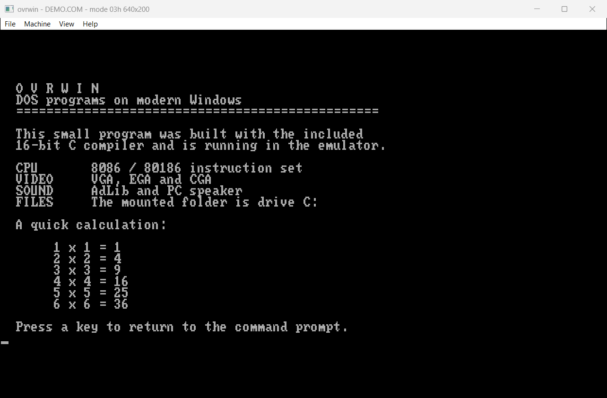

# libdos

[](https://github.com/ZacWalk/libdos/actions/workflows/build.yml)

An embeddable DOS emulator library, and the tools built on it:

- **demu** runs a DOS program from the command line - headlessly, with its
  console on stdout and its exit code returned - and is also the debugger, the
  front end of the C compiler and the test suite. It is what builds
  [dos4z](https://github.com/ZacWalk/dos4z), MS-DOS 4.00 from source, with the
  original 1988 toolchain.
- **dui** is the windowed app: point it at a folder with a DOS game and play.
- **dimg** makes bootable DOS disk images - a floppy, or a hard disk
  partitioned and formatted the way DOS 4.0's FDISK and FORMAT leave one - and
  lists or copies out the files on one. dos4z's boot floppies and the
  CompactFlash card images for an IBM 5150 are made with it.

libdos is not a PC emulator with DOS installed on it. It emulates the hardware
a program talks to - the CPU, the VGA, the timer, the AdLib - and *maps* the
software interfaces, INT 21h and the BIOS, onto the host the way Wine maps the
Win32 API onto Linux. There is no DOS kernel in memory and no disk image: the
folder you open is the emulated C: drive.



*An original demo built with the included 16-bit C compiler.*

Repository: <https://github.com/ZacWalk/libdos>

## What is emulated

| Part | Coverage |
|------|----------|
| CPU | 8086 and 80186: every documented opcode and addressing mode, the segment wrap, BCD arithmetic, and string instructions that resume correctly after an interrupt. Strict 8086 models stop at anything an IBM PC's 8088 does not have |
| Memory | The full 1 MiB real-mode space with the MCB chain, PSP and environment block a program expects to walk |
| VGA / EGA / CGA | 256 KiB of display memory with the graphics controller's four write modes, latches, set/reset and bit mask; text modes, CGA 4/5/6, EGA 0Dh/0Eh/10h, VGA 12h and 13h; the 256-entry DAC and the EGA-compatible palette |
| Timer | 8253 channels 0 and 2. A game that reprograms channel 0 for a music tick gets IRQ 0 at that rate, not at 18.2 Hz |
| Interrupts | Two 8259s with real priority and masking, driving INT 8 and INT 9 through the vector table so a program can hook or chain them |
| Keyboard | 8042 controller with scancodes, the BIOS translation layer and the BIOS keyboard buffer, both reachable |
| Sound | AdLib / OPL2: nine channels, two operators each, four waveforms, envelopes, feedback and both connection modes. PC speaker driven from timer channel 2 |
| Mouse | INT 33h driver with position, buttons, ranges, motion counters and an on-screen pointer |
| DOS | INT 21h: console, handle-based file I/O with DOS's per-process handle tables and redirection, directory search, memory allocation, the DTA, interrupt vectors, dates and times, `EXEC` for child processes and overlays, COMMAND.COM /C carried out natively, and the MZ/COM loader with relocation |

It also comes with a C compiler that targets 16-bit DOS, and a shell written in
C and built with it - see [Building DOS programs](#building-dos-programs).

How it all fits together is in [docs/design.md](docs/design.md). What is missing
or approximate is in [docs/todo.md](docs/todo.md) - headline gaps are Sound
Blaster digital audio, `EXEC` overlay loading, and the 386 instruction set (so
a DOS extender will not run).

## Layout

| Path | Contents |
|------|----------|
| `src/` | The emulator. Platform independent - no Windows headers, no file system. Builds `libdos`. |
| `host/` | The Windows implementation of the host interface: one directory presented as the emulated drive, plus the pages the JIT executes from. Shared by demu and dui, and the last Windows-specific code in the repository. |
| `app/` | dui, written against the shared [platform-h](https://github.com/ZacWalk/platform-h) layer: window, menu, picture, sound and the key mapping, with no operating system named. |
| `cli/` | demu: the test suite, plus tools to inspect, disassemble, trace and headlessly run a program. |
| `cc/` | A C compiler for 16-bit DOS. Platform independent, and it opens no files either. `cc/include` and `cc/lib` are the C library it compiles against. |
| `disk/` | Bootable DOS disk images - FAT12 floppies and partitioned FAT12/FAT16 hard disks - and the reader that finds the files on one again. Platform independent and opens no files: a caller supplies the bytes and a sink or a source for the sectors. Builds `libdos_disk`. |
| `dimg/` | dimg, the command line for `disk/`: the files, the sparse image file and the options. |
| `shell/` | `dos.h` and a DOS command interpreter written in C, built by `cc/`. |
| `tools/` | `make-font.ps1`, which regenerates the character generator in `src/rom-font.cpp`. |
| `docs/` | [design.md](docs/design.md) (architecture) and [todo.md](docs/todo.md) (gaps). |

## Build and run

```powershell
.\dd.ps1 build              # both configurations
.\dd.ps1 test               # build and run the suite
.\dd.ps1 launch             # build Release, then start dui
.\dd.ps1 bench --yes        # compile the benchmark for this machine and run it
.\dd.ps1 bench --exe true --yes   # the same, but as a standalone exe\bench.exe
```

Or with CMake directly - `dd.ps1` only adds finding the toolchain:

```powershell
cmake --preset release
cmake --build --preset release
```

Binaries land in `exe/` as `dui.exe`, `demu.exe` and `dimg.exe`, with a `-d` suffix
for Debug. Build trees go under `build/<preset>/`. The platform layer is pulled
in by `FetchContent` at the revision pinned in `CMakeLists.txt`, except that a
sibling `../platform-h` checkout is used instead when one exists.

## dui

Drop a program or a folder onto the window, open one through **File**, or pass
one on the command line. Whichever you do, the folder becomes the emulated C:
drive and nothing outside it is reachable.

With no program running you get a command prompt, so you can look around before
starting anything:

```
C:\>dir
C:\>cd wasteland
C:\>wl
```

`DIR`, `CD`, `MD`, `RD`, `DEL`, `TYPE`, `CLS`, `VER`, `MEM`, `HELP` and `EXIT`
are built in; anything else is treated as the name of a program to run, with
`.COM` tried before `.EXE`. When the program ends you are back at the prompt.
The prompt is not a DOS program - it uses the same host services INT 21h does,
so what `DIR` lists is exactly what a program will find.

The title bar reports the program, the current video mode and whether the
machine is paused.

| | |
|---|---|
| Ctrl+O / Ctrl+R | Open, Reset back to the prompt |
| F9 | Pause |
| View menu | Sound on/off |

The picture is scaled by a whole number and centred, so a pixel is always a
solid block and never an uneven one. Each axis gets its own factor, bounded so
a pixel is at least square and at most twice as tall as it is wide - roughly
its shape on the display a 200-line mode was written for.

Emulation is paced by the sound card: each frame's audio is queued to the
platform audio stream, and waiting for room in that queue is what keeps the
machine running at real time. With sound off it falls back to the wall clock.

## Building DOS programs

`cc/` is a small C compiler that emits a DOS `.COM`. It exists because the DOS
side of an emulator is much easier to write in C than in hand-assembled bytes,
and because a program compiled here and run there exercises the whole emulator
from one end to the other.

```powershell
.\exe\demu.exe --cc .\shell\hello.c        # writes hello.COM
.\exe\demu.exe --run .\shell\hello.COM --screen
```

A program that wants the C library includes it, because there is nothing to
link with:

```powershell
.\exe\demu.exe --cc prog.c -I cc\include -I cc\lib -D NDEBUG
```

It is one pass with no syntax tree, in the shape of Fabrice Bellard's Tiny C
Compiler - the parser emits 8086 code as it goes. None of TCC's code is used;
it is LGPL and this is not. It accepts most of C89: 32-bit `long`, function
pointers, `goto`, varargs, `static` locals and constant folding over both
integers and floating literals. What it does not have is run-time floating
point, struct assignment, and any memory model beyond the tiny one - a program
is a single `.COM` in a single 64 KiB segment, and there is no linker, so
`cc/lib/libc.c` is included rather than linked. The gaps are listed in
[docs/todo.md](docs/todo.md).

`shell/shell.c` is a DOS command interpreter built with it, following
COMMAND.COM's command set. It runs as a real DOS program inside the emulator
and launches others through INT 21h `EXEC`:

```powershell
.\exe\demu.exe --cc .\shell\shell.c
copy .\shell\shell.COM .\GAME\
.\exe\demu.exe --run .\GAME\SHELL.COM --args "dir" --screen
```

The prompt dui comes up with is a separate, native one: it has to work
before any drive is mounted, and it is there whether or not you have built
anything.

## demu

### Running a program

```powershell
.\exe\demu.exe [options] <program> [arguments]
```

runs a DOS program the way a command line runs a native one: headlessly, to
its end, with its console on stdin, stdout and stderr and its exit code
returned. A host directory is drive C: - `-r <dir>`, or the root of the current
drive - and nothing outside it can be reached. PATH, INCLUDE, LIB, INIT, TMP,
TEMP and COUNTRY are passed in with their paths moved onto that drive (`-e`
adds more), and an entry no DOS program could use, outside the drive or with a
long name, is left out. The date is fixed, 15 June 1988, so a build comes out
the same whenever it runs.

That is what builds [dos4z](https://github.com/ZacWalk/dos4z) - MS-DOS 4.00
from its source, with the original MASM 5.10, CL 5.10, LINK 3.65 and NMAKE -
and every binary comes out byte for byte as it did under the demu that grew
into libdos. NMAKE starting COMMAND.COM /C is carried out natively, built-in
commands, redirection and all; LIB.EXE, an OS/2 bound executable, is stood in
for by an OMF library manager. The processor is a strict 8086 unless `-cpu`
says otherwise (`8086`, `186`, `386`), so a tool doing something an 8088
cannot stops with the reason, rather than quietly doing it.

```powershell
cd C:\src\dos4z\dos\BOOT
demu -r C:\src\dos4z C:\src\dos4z\dos\TOOLS\NMAKE.EXE
```

`-v` reports every DOS call and file open on stderr, `-d` describes the
executable, and `-shell` reports DOS 4.00 rather than 3.20, for running
COMMAND.COM itself.

### The debugger and the test suite

`demu.exe --test` runs the behavioural test suite and returns non-zero on
failure. The same binary is the debugger:

```powershell
.\exe\demu.exe --info GAME.EXE                  # MZ header, memory needed
.\exe\demu.exe --cc program.c [-I dir] [-D name=value]  # compile C to a DOS .COM
.\exe\demu.exe --disasm GAME.EXE 40             # disassemble from the entry point
.\exe\demu.exe --run GAME.EXE --frames 400 --bmp shot.bmp
.\exe\demu.exe --run GAME.EXE --trace           # every DOS and BIOS call
.\exe\demu.exe --run GAME.EXE --trace-tail 200  # the last instructions executed
.\exe\demu.exe --run GAME.EXE --screen --state  # text screen, registers, memory
.\exe\demu.exe --run GAME.EXE --keys " \n" --key-delay 240 --bmp shot.bmp
.\exe\demu.exe --run GAME.EXE --wav sound.wav    # what came out of the speaker
.\exe\demu.exe --run .\GAME --args "dir" --screen  # mount a folder, use the shell
.\exe\demu.exe --bench GAME.EXE --seconds 3     # guest instructions a second
```

`--trace` and `--trace-tail` are how you find out why a program gave up: the
first shows which service it asked for and what it got back, the second shows
the instructions it ran on the way there. `--keys` types on the emulated
keyboard as the program runs, which is what gets a game past its title screen
without dui.

## dimg

```powershell
dimg -o <image> -b <bindir> [options]   # make a floppy, or a hard disk with -hd
dimg -dir <image>                       # list the volumes and the files on them
dimg -extract <image> <path> <file>     # copy a file out: C:\DOS\FORMAT.COM
```

makes a disk that boots the DOS in `<bindir>`: its boot sector from
`MSBOOT.BIN`, then `IO.SYS` and `MSDOS.SYS` as the first two root directory
entries - which the boot sector needs - then the volume label, `COMMAND.COM`
and anything given with `-f`. A floppy is 360 KB (`-s 360`, the default) or
1.44 MB (`-s 1440`).

`-hd <MB>` makes a partitioned hard disk instead, behind FDISK's master boot
record (`FDBOOT.BIN`): C: is the primary partition and logical drives in an
extended partition fill the rest of the disk, up to Z:. Partitions end on a
cylinder of 63 sectors and 16 heads - 255 above 504 MB - and each is laid out as
DOS 4.0's FORMAT lays one out, so FDISK, FORMAT and CHKDSK see what they made
themselves. `-p <MB>` caps a partition (2047 MB at most), `-lba` uses the LBA
partition types 0Eh and 0Fh, `-heads` changes the geometry and `-nosys` leaves
the system files off. The image is a sparse file, so a 32 GB card image takes
the few megabytes that are written; dimg prints the DOSBox `imgmount` line
that matches it.

The files are dated, and the volumes numbered, from the time now - or, for a
build that comes out the same every time, from `-t <seconds since 1970>` or
`SOURCE_DATE_EPOCH`, read as UTC.

`-dir` and `-extract` read any FAT12 or FAT16 image, from dimg or not: a floppy,
or a hard disk's primary partitions then its logical drives, lettered as DOS
letters them.

## Embedding

Link the `libdos` CMake target and include `src/machine.h`. Implement
`host_services` from `src/host.h` to decide what the emulated drive is, then
feed the machine an image (`load_program`), step it with `exec(cycles)`, and
read `framebuffer()` and `generate_audio()`. `app/main.cpp` is a complete
worked host.

Pulled into another CMake project - with `add_subdirectory` or `FetchContent` -
libdos builds only its libraries: `libdos`, `libdos_cc` (the compiler),
`libdos_disk` (disk images) and `libdos_host` (the Windows host).
`LIBDOS_BUILD_TOOLS` and `LIBDOS_BUILD_APP` turn demu and dimg, and dui, on;
they default to on only when libdos is the top-level project, and only dui
fetches the platform layer.

## Licence

MIT - see [LICENSE](LICENSE). Where parts of it came from, including the CPU
core's descent from the reenigne project, is in [NOTICE.md](NOTICE.md).

Contributing, or working on this with an AI agent? See [AGENTS.md](AGENTS.md).
