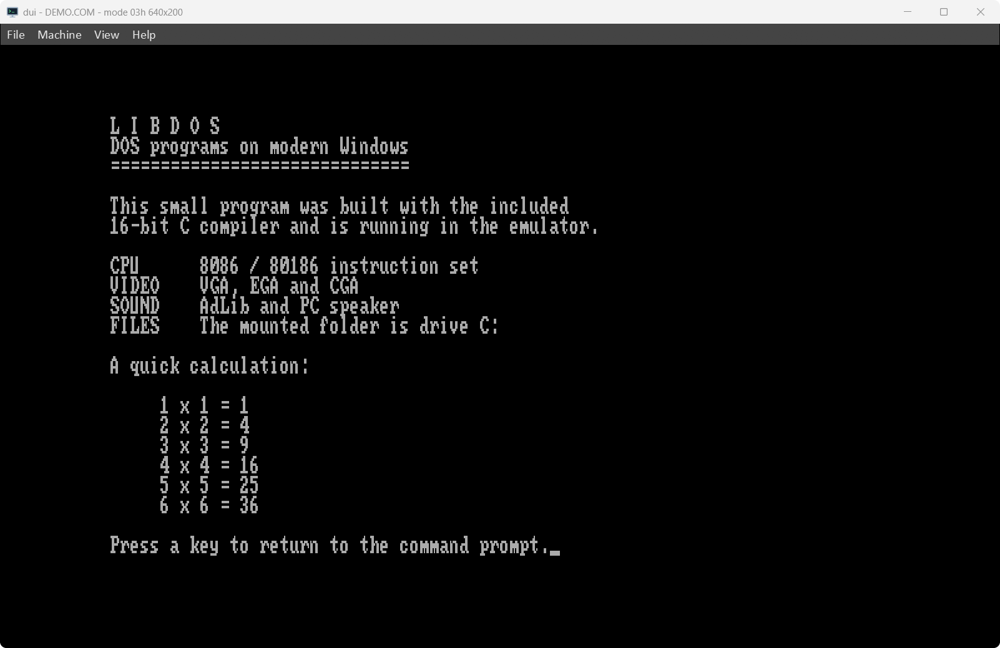

# libdos

[](https://github.com/ZacWalk/libdos/actions/workflows/build.yml)

An embeddable DOS emulator library, and the tools built on it:

- **demu** runs a DOS program from the command line - headlessly, with its
  console on stdout and its exit code returned - and is also the debugger, the
  front end of the C compiler and the test suite. It is what builds
  [dos4z](https://github.com/ZacWalk/dos4z), MS-DOS 4.00 from source, with the
  original 1988 toolchain, and what boots the result to test it (`--boot`).
- **dui** is the windowed app: point it at a folder with a DOS game and play.
- **dimg** makes bootable DOS disk images - a floppy, or a hard disk
  partitioned and formatted the way DOS 4.0's FDISK and FORMAT leave one - and
  lists or copies out the files on one. dos4z's boot floppies and the
  CompactFlash card images for an IBM 5150 are made with it.

libdos is not a PC emulator with DOS installed on it. It emulates the hardware
a program talks to - the CPU, the VGA, the timer, the AdLib - and *maps* the
software interfaces, INT 21h and the BIOS, onto the host the way Wine maps the
Win32 API onto Linux. There is no DOS kernel in memory and no disk image: the
folder you open is the emulated C: drive.

Boot mode is the exception, for testing a DOS rather than running programs on
one: the machine is an IBM PC with nothing mapped in, its BIOS serves disk
images through INT 13h, and it boots whatever is on them - see
[Booting a disk](#booting-a-disk).



*An original demo built with the included 16-bit C compiler.*

Repository: <https://github.com/ZacWalk/libdos>

## What is emulated

| Part | Coverage |
|------|----------|
| CPU | 8086 and 80186: every documented opcode and addressing mode, the segment wrap, BCD arithmetic, and string instructions that resume correctly after an interrupt; and the 80386's two-byte opcodes in their 16-bit forms. The 8086 models stop at anything an IBM PC's 8088 does not have |
| Memory | The full 1 MiB real-mode space with the MCB chain, PSP and environment block a program expects to walk |
| VGA / EGA / CGA | 256 KiB of display memory with the graphics controller's four write modes, both read modes, latches, set/reset and bit mask; text modes, CGA 04h-06h, EGA 0Dh-10h, VGA 11h-13h; the 256-entry DAC and the EGA-compatible palette |
| Timer | 8253 channels 0 and 2. A game that reprograms channel 0 for a music tick gets IRQ 0 at that rate, not at 18.2 Hz |
| Interrupts | Two 8259s with real priority and masking, driving INT 8 and INT 9 through the vector table so a program can hook or chain them |
| Keyboard | 8042 controller with scancodes, the BIOS translation layer and the BIOS keyboard buffer, both reachable |
| Sound | AdLib / OPL2: nine channels, two operators each, four waveforms, envelopes, feedback and both connection modes. PC speaker driven from timer channel 2 |
| Mouse | INT 33h driver with position, buttons, ranges, motion counters and an on-screen pointer |
| DOS | INT 21h: console, handle-based file I/O with DOS's per-process handle tables and redirection, directory search, memory allocation, the DTA, interrupt vectors, dates and times, `EXEC` for child processes and overlays, COMMAND.COM /C carried out natively, and the MZ/COM loader with relocation |
| Disks | In boot mode only: INT 13h over disk images - two floppies, and two hard disks with CHS and the LBA calls - and INT 19h booting from them, on an IBM PC 5150's ROM |

It also comes with a C compiler that targets 16-bit DOS, and a shell written in
C and built with it - see [Building DOS programs](#building-dos-programs). How
it all fits together is in [docs/design.md](docs/design.md).

### What is not

- **32-bit code.** There are no 32-bit operands or addresses and no protected
  mode, so a DOS extender (DOS/4GW, CWSDPMI) will not run. Speed is not the
  limit: `demu --bench` measures tens of millions of guest instructions a
  second on a current PC.
- **A coprocessor.** The x87 escape opcodes consume their operands and do
  nothing, which suits a program that checks for one first.
- **Sound Blaster**, MIDI and the MPU-401: digital sound effects and speech are
  silent. The OPL's envelopes approximate the published rate tables, with no
  vibrato, tremolo or percussion mode, and the PC speaker plays no PWM samples.
- **VESA**, split screen and pixel panning. INT 10h AH=07h clears its window
  rather than scrolling it, and the retrace status on port 3DAh follows the
  cycle count, not a raster position.
- **Parts of DOS.** Of the FCB calls only AH=29h is there, to parse a file
  name, and it takes any drive letter A-Z. EXEC AL=01h is refused. There is no
  network redirector, SHARE or locking, and no Ctrl+C or Ctrl+Break: INT 23h
  and INT 1Bh are never raised and a ^C arrives as character 3. AH=59h always
  reports success, and AH=57h cannot set a file's date and time but says it
  has. The root of the drive lists `.` and `..`, and a far jump to FFFF:0000
  spins.
- **E0 scancodes and a joystick.** An extended key arrives with the numeric
  keypad's scancode, so a program reading raw scancodes cannot tell the two
  pads apart, and NumLock starts off. Port 201h reports no joystick.

## Layout

| Path | Contents |
|------|----------|
| `src/` | The emulator, platform independent. Builds `libdos`. |
| `host/` | The Windows implementation of the host interface: one directory presented as the emulated drive, and the executable memory `demu --ccnative` runs compiled code in. Shared by demu and dui. |
| `app/` | dui, a `ui::shell` over libdesktop's `core`, `platform`, `render` and `ui` libraries: window, drawn menu, keys, the screen's surface element and sound, with its own frame loop. |
| `cli/` | demu: the test suite and the debugger, the program runner (`runner.cpp`, with LIB's stand-in in `lib-omf.c`), and boot mode's headless runner (`boot.cpp`). |
| `cc/` | The C compiler for 16-bit DOS, platform independent. Builds `libdos_cc`; `cc/include` and `cc/lib` are the C library it compiles against. |
| `disk/` | Bootable DOS disk images - FAT12 floppies and partitioned FAT12/FAT16 hard disks - and the reader that finds the files on one again, platform independent. Builds `libdos_disk`. |
| `dimg/` | dimg, the command line for `disk/`: the files, the sparse image file and the options. |
| `shell/` | `dos.h` and a DOS command interpreter written in C, built by `cc/`. |
| `tools/` | `make-font.ps1`, which regenerates the character generator in `src/rom-font.cpp`; `cc-fingerprint.ps1`, which pins what the compiler emits; and `port-gen.py`, which translates the compiler's `gen.cpp` into C. |
| `docs/` | [design.md](docs/design.md), how the emulator works and why, and [cc.md](docs/cc.md), the C compiler. |

## Build and run

Windows x64 only: PowerShell 7.4 or later and Visual Studio's MSVC, CMake and
Ninja. The vendored [dd](https://github.com/ZacWalk/dd) driver finds the
toolchain itself, so no developer prompt is needed:

```powershell
.\dd.ps1 build                          # both configurations, or name debug or release
.\dd.ps1 test --label libdos            # build both, then run the suites
.\dd.ps1 test --label headless          # the same gate, no visible UI, console check counts
.\dd.ps1 launch                         # build Release, then start dui
.\dd.ps1 run cli '--' --info GAME.EXE   # run demu with its own arguments
.\dd.ps1 bench --yes                    # compile cc/bench/bench.c for this machine and run it
.\dd.ps1 bench --exe true --yes         # the same, but as a standalone exe\bench.exe
```

The `'--'` is quoted because PowerShell removes a bare `--` from a script's
arguments, and dd then takes demu's options as its own. Without `--label`,
`dd test` also opens dui's window for a moment as a smoke check.
`.\dd.ps1 commands --json` lists the project's own commands.

Or with CMake directly - `dd.ps1` only adds finding the toolchain:

```powershell
cmake --preset release
cmake --build --preset release
```

Binaries land in `exe/` as `dui.exe`, `demu.exe` and `dimg.exe`, with a `-d`
suffix for Debug; build trees go under `build/<preset>/`. libdesktop's four
libraries are fetched at the revision pinned in `CMakeLists.txt`, unless a
sibling `../libdesktop` checkout exists, which is used instead. After a build
the suites also run directly: `.\exe\demu.exe --test` returns non-zero on
failure, and `& .\exe\dui.exe -test 2>&1 | Out-Host; $LASTEXITCODE` checks dui
offscreen. The pipe makes PowerShell wait for the GUI-subsystem executable.
Both labelled gates print the real emulator and UI check counts, including
successful cases. After building,
`ctest --preset debug -L headless -V --no-tests=error` reruns without rebuilding;
use `release` for Release.

Every [release](https://github.com/ZacWalk/libdos/releases) has the three for
Windows x64 in a zip, with its SHA-256 alongside; dos4z's build downloads one.

## dui

Drop a program or a folder onto the window, open one through **File**, or pass
one on the command line. Whichever you do, the folder becomes the emulated C:
drive and nothing outside it is reachable.

With no program running you get a command prompt, so you can look around before
starting anything:

```
C:\>dir
C:\>cd wasteland
C:\>wl
```

It has COMMAND.COM's built-in commands - DIR, CD, COPY, DEL, REN, TYPE, ATTRIB
and the rest - plus MEM, HELP and EXIT; anything else is the name of a program
to run, `.COM` tried before `.EXE`. When the program ends you are back at the
prompt. The prompt is not a DOS program: it uses the same host services INT
21h does, so what `DIR` lists is exactly what a program will find. It runs no
batch files, has no redirection, pipes or history, edits a line only with
Backspace, and its `DIR` ignores `/W` and `/P`.

The title bar reports the program, the current video mode and whether the
machine is paused.

| | |
|---|---|
| Ctrl+O / Ctrl+R | Open, Reset back to the prompt |
| F9 | Pause |
| View menu | Sound on/off |

Alt, Alt+key and F10 belong to the menu bar and never reach the program, and
neither Pause nor Ctrl+Break is mapped: **Machine > Reset** is the way out of a
program that will not end. dui has no boot mode and no save states, and does
not remember its window placement or the sound setting.

The picture is scaled by a whole number and centred, so a pixel is always a
solid block and never an uneven one. Each axis gets its own factor, bounded so
a pixel is at least square and at most twice as tall as it is wide - roughly
its shape on the display a 200-line mode was written for.

Emulation is paced by the sound card: each frame's audio is queued to the
platform audio stream, and waiting for room in that queue is what keeps the
machine running at real time. With sound off it falls back to the wall clock.

## Building DOS programs

`cc/` is a small C compiler that emits a DOS `.COM`:

```powershell
.\exe\demu.exe --cc .\shell\hello.c        # writes hello.COM
.\exe\demu.exe --run .\shell\hello.COM --screen
```

A program that wants the C library includes `libc.c`, because there is nothing
to link with:

```powershell
.\exe\demu.exe --cc prog.c -I cc\include -I cc\lib
```

It compiles a large part of C89 - 32-bit `long`, function pointers, `goto`,
varargs and `static` locals among it - but has no floating point at run time,
no structure assignment, and only the tiny model: one `.COM` in one 64 KiB
segment. What it accepts, its library and how it works are in
[docs/cc.md](docs/cc.md).

`shell/shell.c` is a DOS command interpreter built with it, following
COMMAND.COM's command set. It runs as a real DOS program inside the emulator
and launches others through INT 21h `EXEC`:

```powershell
.\exe\demu.exe --cc .\shell\shell.c
copy .\shell\shell.COM .\GAME\
.\exe\demu.exe --run .\GAME\SHELL.COM --args "dir" --screen
```

Like dui's prompt, it runs no batch files and has no redirection or pipes. The
prompt dui comes up with is a separate, native one: it has to work before any
drive is mounted, and it is there whether or not you have built anything.

## demu

`demu` with no arguments lists every command and option.

### Running a program

```powershell
.\exe\demu.exe [options] <program> [arguments]
```

runs a DOS program the way a command line runs a native one: headlessly, to
its end, with its console on stdin, stdout and stderr and its exit code
returned. A host directory is drive C: - `-r <dir>`, or the root of the current
drive - and nothing outside it can be reached. PATH, INCLUDE, LIB, INIT, TMP,
TEMP and COUNTRY are passed in with their paths moved onto that drive (`-e`
adds more), and an entry no DOS program could use, outside the drive or with a
long name, is left out. The date is fixed, 15 June 1988, so a build comes out
the same whenever it runs.

That is what builds [dos4z](https://github.com/ZacWalk/dos4z) - MS-DOS 4.00
from its source, with the original MASM 5.10, CL 5.10, LINK 3.65 and NMAKE.
NMAKE starting COMMAND.COM /C is carried out natively, built-in commands,
redirection and all; pipes and batch files are refused, and FOR runs only
built-in commands. LIB.EXE, an OS/2 bound executable, is stood in for by an
OMF library manager, which reaches files only under `-r` as a program would and
fails as LIB does when one cannot be read or written; given a response file,
it writes a new library from the modules listed rather than updating the one
there. The processor is a strict 8086 unless `-cpu` says otherwise, so a tool
doing something an 8088 cannot stops with the reason, rather than quietly
doing it.

```powershell
cd C:\src\dos4z\dos\BOOT
demu -r C:\src\dos4z C:\src\dos4z\dos\TOOLS\NMAKE.EXE
```

### Booting a disk

```powershell
demu --boot -a dos.img [-c hd.img] --expect "A>" --line "dir" --expect "bytes free" --screen
```

powers on an IBM PC 5150 - an 8088 at 4.77 MHz, 640 KB, the ROM's model byte
and date - with disk images as its floppies (`-a`, `-b`) and hard disks (`-c`,
`-d`), and boots from A: if it has a floppy and C: if not. Nothing is mapped
in: the DOS on the disk brings its own INT 21h, and the BIOS under it is
libdos's, with INT 13h reading and writing the images. A hard disk has the
geometry its partition table was made for - each partition ends on a
cylinder, so its last head and sector say - or, blank, dimg's for its size. It
has the LBA calls, AH=41h-48h, unless `--no-lba` takes them away, so both of a
DOS's paths to a disk can be tried, and like the XT-IDE Universal BIOS it moves
at most 127 sectors a call.

The steps that follow run in order against everything written through INT
10h: wait for text, type, press a key, reboot. A key goes in once the console
has been quiet for a moment, as a person types, so a program that flushes the
keyboard after its prompt still gets it. demu exits 0 when every step has
happened and every key typed has been read, 1 when an `--expect` timed out or
keys were left unread, and 2 when the machine stopped - as the 8086 model does
at any instruction an 8088 does not have.

The BIOS is an XT's with an XT-IDE card's disks rather than the 5150's own to
the letter: INT 13h answers AH=08h and 15h for a floppy, and has no DMA
boundary error, no change line and no AH=17h or 18h. INT 14h and 17h, the
serial and printer BIOS, do nothing; there is no Ctrl+Alt+Del, so a test
restarts with `--reboot`; and the display is libdos's VGA in mode 3.
`--expect` sees only what goes through INT 10h: a program writing straight to
video memory shows on `--screen` but not to `--expect`.

#### dui icon

`python tools\generate_icon.py` regenerates the DOS-terminal icon in
`app\res\dui.ico`, in nine desktop sizes. Add `--check` to verify without
writing, or `--output tmp\icon-128.png --size 128` to export another size.
The generator uses Python 3.9+'s standard library and its vendored
`tools\iconlib.py`; neither demu nor dimg gains a desktop dependency.

## The debugger and the test suite

`demu.exe --test` runs the behavioural test suite and returns non-zero on
failure. The same binary is the debugger:

```powershell
.\exe\demu.exe --info GAME.EXE                  # MZ header, memory needed
.\exe\demu.exe --disasm GAME.EXE 40             # disassemble from the entry point
.\exe\demu.exe --run GAME.EXE --frames 400 --bmp shot.bmp
.\exe\demu.exe --run GAME.EXE --trace           # every DOS and BIOS call
.\exe\demu.exe --run GAME.EXE --trace-tail 200  # the last instructions executed
.\exe\demu.exe --run GAME.EXE --screen --state  # text screen, registers, memory
.\exe\demu.exe --run GAME.EXE --keys " `n" --key-delay 240 --bmp shot.bmp
.\exe\demu.exe --run GAME.EXE --wav sound.wav   # what came out of the speaker
.\exe\demu.exe --run .\GAME --args "dir" --screen  # mount a folder, use the shell
.\exe\demu.exe --bench GAME.EXE --seconds 3     # guest instructions a second
```

`--keys` types on the emulated keyboard as the program runs - letters, digits,
space, Enter and Esc - which is what gets a game past its title screen without
dui. To find out why a program does not work, in order:

1. `--trace` prints every DOS and BIOS call with its arguments and the address
   it came from. Nearly every failure shows here as a service returning
   something the program did not expect.
2. `--trace-tail n` prints the last `n` instructions executed, with registers:
   for a program that gives up without asking for anything.
3. `--bmp file` writes the final frame. The text-screen dump (`--screen`) is
   meaningless in a graphics mode; the bitmap is not.
4. `--state` prints registers, memory, open files and a disassembly window.

## dimg

```powershell
dimg -o <image> -b <bindir> [options]   # make a floppy, or a hard disk with -hd
dimg -dir <image>                       # list the volumes and the files on them
dimg -extract <image> <path> <file>     # copy a file out: C:\DOS\FORMAT.COM
```

makes a disk that boots the DOS in `<bindir>` - a 360 KB or 1.44 MB floppy,
or with `-hd` a hard disk behind FDISK's master boot record, C: then logical
drives up to Z: - laid out as DOS 4.0's FDISK and FORMAT lay one out, so that
FDISK, FORMAT and CHKDSK on the machine see what they made themselves. The
image is a sparse file, so a 32 GB card image takes the few megabytes written,
and dimg prints the DOSBox `imgmount` line that matches it. `-t` or
`SOURCE_DATE_EPOCH` fixes the dates and volume serial numbers, so a build
comes out the same every time. `dimg -h` lists every option.

`-dir` and `-extract` read any FAT12 or FAT16 image, from dimg or not, and
letter a hard disk's partitions as DOS 4.0 does: the first primary partition
of a DOS type is C:, then each logical drive of one, formatted or not. A
partition DOS gives no letter is listed with no drive to extract from, a FAT32
one is listed as one it cannot read, and long file names are skipped. A
damaged image - a chain of clusters or partitions that loops - is reported
rather than followed.

dimg only makes new images: it cannot add a file to one, make a subdirectory,
or write into an image DOS has used. A hard disk always has 63 sectors a
track, so a card set up at another geometry needs partitions made by FDISK on
that machine.

## Embedding

Link the `libdos` CMake target and include `machine.h`. Implement
`host_services` from `src/host.h` to decide what the emulated drive is, then
feed the machine an image (`load_program`), step it with `exec(cycles)`, and
read `framebuffer()` and `generate_audio()`. `host/host-win32.cpp` is a
complete `host_services`, and `app/main.cpp` a complete host application. For
boot mode, implement `block_device` from `src/block-device.h` over wherever the
disk's sectors live, `attach_disk` it and `power_on`; `cli/boot.cpp` does that
with image files.

Pulled into another CMake project - with `add_subdirectory` or `FetchContent` -
libdos builds only its libraries: `libdos`, `libdos_cc` (the compiler),
`libdos_disk` (disk images) and `libdos_host` (the Windows host).
`LIBDOS_BUILD_TOOLS` and `LIBDOS_BUILD_APP` turn demu and dimg, and dui, on;
they default to on only when libdos is the top-level project, and only dui
fetches libdesktop.

## Licence

MIT - see [LICENSE](LICENSE). Where parts of it came from, including the CPU
core's descent from the reenigne project, is in [NOTICE.md](NOTICE.md). dui
includes [libdesktop](https://github.com/ZacWalk/libdesktop), which is licensed
under the Mozilla Public License 2.0: anyone distributing `dui.exe` - including
the one in each release zip - must tell its recipients where to get libdesktop's
source code, including any changes made to it. demu and dimg do not link it.
`tools/iconlib.py` is vendored from libdesktop under the same licence.

Contributing, or working on this with an AI agent? See [AGENTS.md](AGENTS.md).